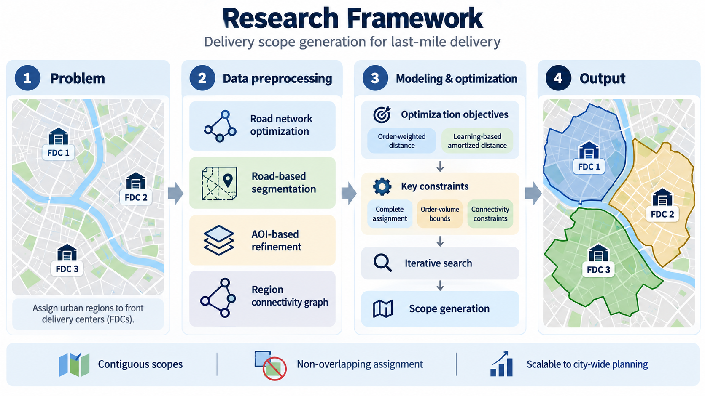
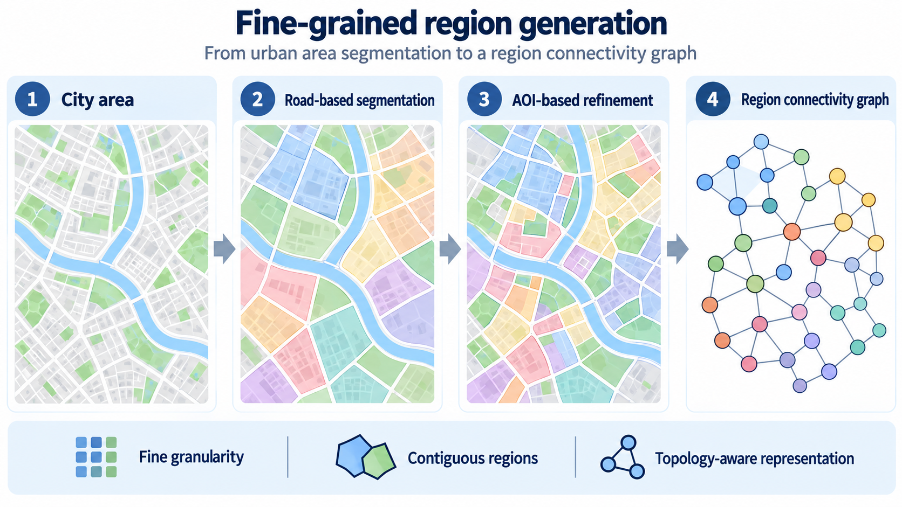
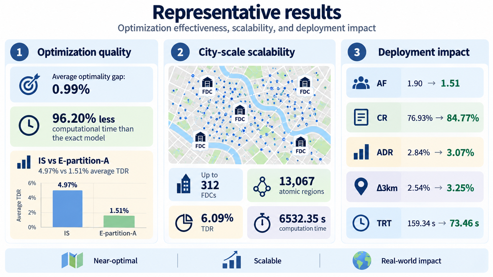

# Delivery Scope Generation for Last-mile Delivery

**Fine-grained Urban Area Segmentation, Modeling, and Optimization**

**CIKM 2026 · Applied Research Track (Poster)**  
**Authors:** Zhongkai Bao, Jing Zhao, Wei Liang, Ning Chen  
**Affiliation:** Dingdong (Cayman) Limited, Shanghai, China  
**DOI:** [10.1145/3799682.3840112](https://doi.org/10.1145/3799682.3840112) *(publication link may not yet be active)*

> This page is an independently written research overview. It does not include the camera-ready paper or reproduce its original figures.

## Overview

Non-overlapping delivery scope generation assigns urban areas to fixed front delivery centers (FDCs) while maintaining **complete coverage, spatial contiguity, and order-volume limits**. At city scale, this is challenging because road-derived regions may be too coarse, AOIs are spatially fragmented, and exact optimization becomes computationally expensive.

We introduce an end-to-end framework combining **fine-grained geographic segmentation, region connectivity modeling, a two-stage optimization formulation, and model-enhanced iterative search**. The framework supports both order-weighted delivery distance and learning-estimated amortized delivery distance.

*Figure 1. Overview of the proposed delivery scope generation framework (newly created schematic illustration).*

## Problem and Contributions

The framework addresses three practical challenges: (1) generating useful and geographically meaningful assignment units; (2) enforcing connected, non-overlapping scopes with FDC capacity constraints; and (3) scaling optimization to hundreds of FDCs while accommodating different delivery-distance objectives.

Our main contributions are:

- **Spatial representation:** combine road and waterway segmentation with AOI-aware refinement to construct fine-grained atomic regions.
- **Connectivity-aware assignment:** explicitly identify regional adjacency and model contiguous delivery scopes using a region graph.
- **Scalable optimization:** integrate a two-stage mixed-integer programming formulation with multi-start variable neighborhood descent (VND) and exact local refinement.
- **Industrial validation:** evaluate the framework on real-world geographic and order data, including city-wide planning and deployed operations.

## Methodology

### 1. Urban Area Segmentation and Connectivity Identification

We clean the road network by filtering minor roads, consolidating parallel segments, and extending selected dead ends; then segment the area using roads and waterways and refine irregular regions. Large road-derived regions are further divided using AOI adjacency extraction, clustering, boundary expansion, and segmentation.

Each resulting atomic region is represented as a **graph vertex**. Adjacency edges are identified by distance screening, exclusion of diagonal-only contacts, and shared-boundary verification. Auxiliary edges connect otherwise disconnected graph components for the assignment formulation.

*Figure 2. Conceptual workflow of fine-grained region generation and topology-aware connectivity identification (newly created schematic illustration).*

### 2. Mathematical Modeling

With fixed FDC locations, the model assigns each atomic region to exactly one FDC under **minimum/maximum order volume** and **region connectivity** constraints. Two objectives are considered separately:

- **Order-weighted delivery distance:** aggregate region order volumes weighted by navigation distance to their assigned FDCs.
- **Amortized delivery distance:** evaluate courier multi-order delivery costs using a GNN-based estimator as a plug-in objective evaluator, not a newly proposed predictive architecture.

The **two-stage enhanced model** first solves an assignment model without connectivity constraints, then identifies a sink region for each FDC from the relaxed assignment and adds flow-based connectivity constraints. This reduces the need for extra sink-selection binaries and large-constant constraints.

### 3. Model-enhanced Iterative Search

For large instances, **Iterative Search (IS)** operates on adjacent FDC pairs and boundary regions. It uses multiple perturbed starts, VND neighborhoods (move in either direction or swap), and an exact reduced-model refinement of the best solution. Assigned atomic regions are then merged into continuous, non-overlapping delivery polygons.

## Key Experimental Results

Experiments use data from **five Chinese cities**. The following findings correspond to distinct evaluation settings and should not be treated as one combined benchmark.

- **Near-optimality:** On the **96 instances** where the two-stage exact model proved optimality, IS had an average **0.99% objective gap** with **96.20% less computation time**. The solved subset may be easier than the unsolved instances.
- **Published baseline:** Across **200 instances**, IS achieved **4.97%** average total distance reduction (TDR) versus **1.51%** for adapted E-partition-A; average runtimes were **18.30 s** and **4.72 s**, respectively.
- **Segmentation:** Average region compactness (Polsby–Popper) increased from **0.2509** to **0.6165** after geometric refinement and **0.6192** after AOI-based segmentation, while retaining **over 99.8%** of order volume. AOI-aware segmentation improved average TDR from **4.68%** to **4.97%** relative to road-only regions.
- **Alternative objective:** Preliminary experiments with a GNN-based amortized-distance evaluator yielded average TDRs of **4.17%**, **3.88%**, and **3.54%** for 5-, 10-, and 15-FDC instances, respectively, with average runtime below six minutes.

### City-scale planning

| FDCs | Atomic regions | TDR | Computation time |
|---:|---:|---:|---:|
| 44 | 2,011 | 5.12% | 237.41 s |
| 117 | 6,602 | 5.67% | 2,227.84 s |
| **312** | **13,067** | **6.09%** | **6,532.35 s** |

*Figure 3. Summary of solution quality, city-scale performance, and industrial deployment metrics (newly created illustrative visualization; values are from the reported experiments).*

## Industrial Deployment

The system has been deployed at **Dingdong**, which operates across **25 cities**, with **over 1,000 FDCs** and **more than one million daily orders**. Teams use its delivery-scope recommendations, may refine them manually, and publish adopted scopes to downstream systems.

A **before/after comparison** using three months of post-deployment data reports:

| Metric | Before | Deployed system | Change |
|---|---:|---:|---:|
| Adjustment Frequency (AF) | 1.90 | 1.51 | −20.52% |
| Consistency Ratio (CR) | 76.93% | 84.77% | +7.84 percentage points |
| Average Distance Reduction (ADR) | 2.84% | 3.07% | +0.23 percentage points |
| Reduction in orders beyond 3 km (Δ3km) | 2.54% | 3.25% | +0.71 percentage points |
| Total Running Time (TRT) | 159.34 s | 73.46 s | −53.90% |

**CR** measures the order-volume overlap between recommended and adopted scopes divided by the larger scope's order volume. These observational deployment results do not establish randomized causal effects.

## Conclusion and Outlook

Fine-grained spatial representation, explicit connectivity constraints, and hybrid heuristic–exact search enable practical large-scale delivery-scope optimization. Future work will **jointly optimize FDC locations and delivery scopes** instead of fixing the facility network in advance.

## Publication and Availability

**Zhongkai Bao, Jing Zhao, Wei Liang, and Ning Chen.** *Delivery Scope Generation for Last-mile Delivery: Fine-grained Urban Area Segmentation, Modeling, and Optimization.* Proceedings of the 35th ACM International Conference on Information and Knowledge Management (CIKM 2026), Applied Research Track. DOI: [10.1145/3799682.3840112](https://doi.org/10.1145/3799682.3840112).

The paper PDF, source code, and original operational datasets are **not included** in this repository. Data availability is subject to desensitization and applicable permissions. All three images are newly generated **conceptual/illustrative figures**, not copies of paper figures or geographic data visualizations.
